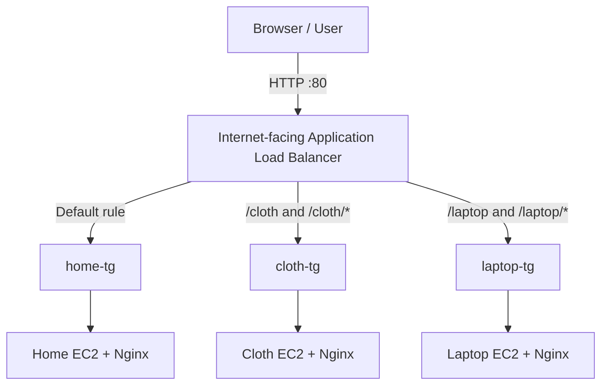

# AWS Shopping Website — Path-Based Routing with an Application Load Balancer

A hands-on AWS project that hosts three static shopping website sections on separate EC2 backends and routes requests through one Application Load Balancer (ALB) using URL path rules.

> **Status:** All three ALB routes were reported as displaying their expected pages. An additional EC2 instance was reported as launching automatically in an Auto Scaling group. Confirm the ASG Activity history, instance `InService` state, and target-group health before describing scale-out as fully verified. Screenshots are not included yet.

## Project overview

The demo contains three sections:

- **Home** — default ALB route
- **Cloth** — `/cloth` and `/cloth/*`
- **Laptop / Electronics** — `/laptop` and `/laptop/*`

Each section is hosted on a separate EC2 backend using Nginx to serve static HTML. The ALB listens on HTTP port 80 and forwards requests to the matching target group based on the requested path.

This is a learning project demonstrating Layer 7 routing. It is not a complete production e-commerce application or a full microservices platform.

## Architecture



## AWS components

| Component | Purpose |
|---|---|
| Amazon EC2 | Hosts the three website backends |
| Nginx | Serves static HTML |
| Application Load Balancer | Single entry point and path-based routing |
| Target groups | Forward requests to the relevant backend |
| Launch templates | Define instance launch configuration |
| Auto Scaling groups | Manage EC2 capacity; see verification notes below |
| VPC and subnets | Provide network connectivity |
| Security groups | Control traffic |

**Region:** `us-east-1` (US East — N. Virginia)  
**ALB name:** `shopping-alb`  
**Listener:** HTTP port `80`  
**ALB DNS used during testing:** `alb-2024001640.us-east-1.elb.amazonaws.com`

The ALB DNS name is AWS-assigned and may change if the load balancer is recreated.

## Routing and test results

| Request | Target group | Reported result |
|---|---|---|
| `/` (default) | `home-tg` | Verified |
| `/cloth` and `/cloth/*` | `cloth-tg` | Verified |
| `/laptop` and `/laptop/*` | `laptop-tg` | Verified |

The configured listener priorities were 10 for Cloth and 20 for Laptop. Requests that do not match those path rules use the default Home target group.

Test using the ALB DNS name, not an EC2 public IP:

- Home: `http://alb-2024001640.us-east-1.elb.amazonaws.com/`
- Cloth: `http://alb-2024001640.us-east-1.elb.amazonaws.com/cloth/`
- Laptop: `http://alb-2024001640.us-east-1.elb.amazonaws.com/laptop/`

## Implementation summary

### 1. Install Nginx on Ubuntu

Example commands used on a backend:

```bash
sudo apt update
sudo apt install nginx -y
```

### 2. Place static HTML in the Nginx web root

Create an HTML page, then copy it to the web root:

```bash
nano index.html
sudo cp -f index.html /var/www/html/
```

For a path-specific directory where needed:

```bash
sudo mkdir -p /var/www/html/cloth
sudo cp -f index.html /var/www/html/cloth/index.html
```

For the Laptop page, use the corresponding `laptop` directory. These are example commands; confirm the files currently on each EC2 instance before reusing them.

### 3. Configure target groups and listener rules

Use one target group per backend: `home-tg`, `cloth-tg`, and `laptop-tg`. Use HTTP on the Nginx port (normally 80), configure a valid health-check path, and ensure the ALB rules forward to the intended target groups.

### 4. Configure launch templates and Auto Scaling groups

Separate launch templates and Auto Scaling groups were created for Home, Cloth, and Laptop.

An additional EC2 instance was reported as launching automatically. To verify a successful policy-driven scale-out:

1. Open **EC2 → Auto Scaling Groups → your group → Activity**.
2. Confirm a successful launch event and inspect its cause.
3. Confirm the new instance reaches `InService` in Instance management.
4. Confirm it is healthy in the relevant target group.

If desired capacity was manually increased, that is different from a scaling policy triggering scale-out. This report does not verify automatic instance replacement or scale-in.

## Verification status

| Check | Status | Notes |
|---|---|---|
| Home route through ALB | Verified | Expected page displayed |
| Cloth route through ALB | Verified | Expected page displayed |
| Laptop route through ALB | Verified | Expected page displayed |
| Additional ASG instance launch | Reported; confirm Activity history | Verify cause and `InService` state |
| New instance target health | Not documented | Check the target group in the console |
| Automatic replacement / scale-in | Not verified | Separate behaviours from scale-out |
| HTTPS/TLS and custom domain | Not implemented or verified | Testing used HTTP port 80 |
| Database, cart, checkout, authentication | Not implemented | Static pages only |
| Screenshots | Not available yet | Add them later if desired |

## Troubleshooting

### 404 when accessing an EC2 public IP

A direct EC2 request bypasses ALB listener rules. Use the ALB DNS name for path-based routing tests.

### Unhealthy target

Check that Nginx is running, the target group uses the correct port and health-check path, and the EC2 security group permits HTTP traffic from the ALB security group.

```bash
sudo systemctl status nginx
curl -I http://localhost/
```

### Wrong page for a path

Check listener priorities and path patterns, target-group mapping, and the HTML content served by each backend.

## Security and cost notes

- Restrict inbound ALB HTTP access to intended clients where possible.
- Allow backend HTTP traffic from the ALB security group rather than from all internet sources.
- Restrict SSH to your own IP when needed.
- Never commit AWS access keys, private SSH keys (`.pem`), passwords, or other secrets.
- The ALB, running EC2 instances, and EBS volumes can incur charges.
- Before cleanup, review ASGs, EC2 instances, ALB, target groups, launch templates, EBS volumes, snapshots, and Elastic IPs. Check dependencies before deleting resources.

## Key learnings

- ALB path-based routing for HTTP requests
- Target groups and EC2 backends
- Nginx static website hosting on Ubuntu
- Difference between direct EC2 access and ALB routing
- The purpose of launch templates and Auto Scaling groups

## Future improvements

- Finish documenting ASG scale-out verification.
- Add HTTPS with an ACM certificate and a domain name.
- Add CloudWatch metrics and alarms.
- Automate instance configuration with user data.
- Containerize the site and build a CI/CD pipeline with GitHub Actions.

## Repository structure

```text
aws-shopping-website/
├── README.md
├── aws-shopping-website-documentation.docx
├── docs/
│   └── architecture.md
├── website/
│   ├── home/
│   │   └── index.html
│   ├── cloth/
│   │   └── index.html
│   └── laptop/
│       └── index.html
└── .gitignore
```

The `website/` HTML files should be replaced with your actual page source. The templates in this package are clearly marked placeholders, not copies of the files deployed on EC2.
